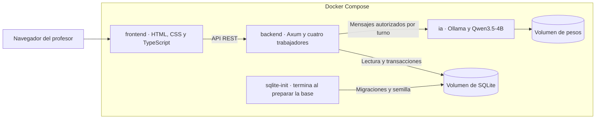

# Módulo 01 · Entrevista, valoración y devolución de un caso

**Objetivo.** Observar si un estudiante puede entrevistar a LR, obtener hallazgos con los instrumentos de SIRCLE y justificar una hipótesis que el profesor pueda revisar. La medición educativa empieza **antes de mostrar la información clínica** y se repite **después de entregar, antes de ver la devolución**. Así el profesor puede comparar desempeño y percepción, y examinar la evidencia que produjo el estudiante.

La primera demostración completa usa LR. El repositorio contiene además los escenarios de Nannu y Dan Sparks para diseñar y ensayar sus agentes por separado. El equipo del profesor es el objetivo de la demostración local. La instalación para una cohorte de 100 estudiantes tiene otro criterio de capacidad que se comprobará con carga. Esta revisión entrega diseño, prompts, referencias y datos de origen. Los apartados de ejecución describen la futura implementación.

## Qué conviene decidir con el profesor

| Pregunta | Por qué cambia el diseño | Propuesta para la primera demostración |
|---|---|---|
| ¿Qué habilidad queremos observar en LR? | Una entrevista, una valoración de enfermería y el manejo completo del escenario requieren evidencias diferentes. | Valorar y justificar una hipótesis inicial. Preparar una pregunta nueva del profesor y una entrega parcial que permita discutir la devolución. |
| ¿Qué versión de LR se enseñará? | El triaje original registra **148/85 mmHg y pulso 102/min**. El HTML de Semana 5 usa **128/78 y 112/min**. Mezclarlos volvería contradictorios el brazo, la ficha y la evaluación. | Elegir una pareja de valores, documentar procedencia y motivo de adaptación, aprobar una ficha en español y fijar su versión al abrir el intento. Mientras tanto ambos pares son referencias para la discusión. |
| ¿Hasta dónde llega la simulación? | Mostrar un instrumento cuesta menos que validar qué efecto produce un tratamiento o cuándo cambia la paciente. | Conservar todas las interacciones visuales de LR y activar hallazgos, órdenes y ayudas según contenido revisado. Para un examen adicional acordar resultado y condición de disponibilidad. Dejar la evolución clínica completa para una iteración con reglas aprobadas. |
| ¿Quién habla y quién evalúa? | La paciente sabe lo que ha vivido. Un instrumento observa, el estudiante interpreta y el profesor juzga el trabajo. | Separar estos cuatro orígenes en el historial. Una solicitud de ayuda abre una orientación docente predefinida y queda identificada como tal. |
| ¿Dónde se demostrará y con cuánta gente? | Una consulta fluida en el equipo de desarrollo dice poco sobre el primer turno en otro equipo o sobre un grupo concurrente. | Comenzar en el computador del profesor, repetir con 20 según RR01 y ensayar 100 sesiones en hardware documentado. El uso universitario requiere medir cuántas inferencias coinciden realmente. |

## Material que acompaña al clon

| Material versionado en el repositorio | Uso |
|---|---|
| [HTML de Semana 5](../referencias/html-semana5/Paciente_Virtual.html) y su carpeta adyacente `recursos/` | Referencia visual e interactiva íntegra, con escenas para los tres pacientes. Permite comparar pantallas sin acceder a Figma. Se conserva en documentación. No se sirve a los estudiantes, porque contiene datos y respuestas de demostración. |
| [Recursos audiovisuales](../../recursos-audiovisuales/) y [láminas de la interfaz](../referencias/interfaz/) | Instrumentos, expresiones, escenas, capturas, wireframes, iconos, licencias y tipografía locales. Roboto, cabecera `#4C84E8`, navegación `#5D92E6`, superficies `#FEFEFB`, apoyo `#9DBEF1` y texto `#161616`. |
| [Requisitos del proyecto](<../requisitos/Documento de requerimientos - Paciente virtual en SIRCLE.md>) y [ocho capas](../referencias/investigacion/ocho-capas.md) | Fuente de CU, RF, pruebas y razonamiento sobre agentes. Los documentos de antecedentes conservan el contexto de sus iteraciones. |
| [LR](../../datos/medsp1000/mededportal_10181/scenario1/), [Nannu](../../datos/medsp1000/mep_2374-8265.10924-s001/scenario3/) y [Dan Sparks](../../datos/medsp1000/mededportal_3171/scenario1/) | Los 14 archivos originales seleccionados, organizados por escenario y por actor, participante, entorno y evaluador. La [ficha del dataset](../../datos/medsp1000/README.md) conserva la atribución y el contexto del material. |
| [Adaptación española de LR](../../datos/adaptaciones/lr/) y [ensayo histórico](../referencias/ensayo-lr/alcance-y-pruebas.md) | La entrevista adaptada y las pruebas previas se pueden cotejar con el original. Útiles para regresión y para decidir qué contenido aprueba el docente. |

El clon contiene los materiales propios del prototipo. En la futura entrega también incluirá los Dockerfiles, Compose, migraciones y reglas de preparación. El equipo necesitará Docker con Compose y espacio para imágenes y pesos. Qwen se descarga una vez desde el registro oficial o se reutiliza desde un almacén compatible y comprobado. Los pesos persisten en disco y se cargan en RAM o VRAM durante la inferencia. Para una demostración sin red hay que preparar y verificar esos artefactos con antelación. [Distribución oficial del modelo](https://ollama.com/library/qwen3.5:4b)

**Dos límites del material original.** El archivo del electrocardiograma de Dan referencia un JPG que falta en la distribución local. El controlador de LR contiene tres referencias de imagen con los datos base64 abreviados. La semilla conservará esas referencias y marcará el medio como no disponible. Una actividad puede usar un informe textual aprobado. Mostrar o puntuar la interpretación de una imagen requerirá incorporar el archivo auténtico.

## Cuatro agentes independientes

| Agente | Qué sabe y cómo responde | Prueba que distingue su trabajo |
|---|---|---|
| **P01 · LR** | Habla en primera persona sobre su experiencia. En el original, el inicio de la disnea es de dos días y desconoce sus antecedentes familiares por adopción. El controlador custodia el triaje y los instrumentos. | Preguntar de dos maneras cuándo empezó y luego por la familia. Preservar duración y desconocimiento explícito. Una pregunta ambigua sobre «eso» puede necesitar aclaración. |
| **P02 · Nannu (Nanu en la fuente)** | Su escenario describe tos y fiebre de tres días. El guion atribuye parte de la historia al familiar. Nanu y su acompañante tienen fuentes y turnos identificables. En Semana 5 aparece la grafía «Nannu». | Distinguir el dolor que refiere Nanu de la expectoración que describe el familiar. Cambiar de hablante conserva la atribución. Mantener P02 cuando se acuerde el nombre visible. |
| **P03 · Dan Sparks** | Su relato sitúa el inicio hace cuatro horas, mientras trabajaba en el jardín. Conoce lo que sintió. Los informes y la conclusión docente se abren por sus propios canales. | Preguntar por el inicio inmediatamente después de entrevistar a LR. Debe conservar cuatro horas. Preguntar por una imagen pendiente preserva la incertidumbre diagnóstica. |
| **Evaluador formativo** | Recibe la entrega confirmada, su rúbrica y las evidencias de ese intento. Para una acción observable usa el evento. Para una justificación escrita puede proponer una interpretación. | Distinguir «mediría la presión» de una medición registrada. Cada crédito cita una evidencia existente. Cuando falta el registro técnico o hay duda de interpretación, propone revisión docente. |

Cada agente tiene un identificador fijo, instrucciones propias, una lista de operaciones permitidas y una entrada de trabajo independiente. La propuesta concreta es iniciar cuatro procesos trabajadores desde el contenedor del backend. La API autoriza la solicitud, identifica el agente a partir del intento guardado y le pasa un mensaje con los hechos y turnos permitidos. El trabajador devuelve el resultado al backend, que lo valida y persiste. Los trabajadores carecen de una interfaz para consultar libremente la base. La separación de procesos aísla memoria y fallos del trabajador. El contenedor y el motor siguen siendo recursos de infraestructura compartidos.

SQLite es dueño de la memoria duradera del intento. Dos estudiantes que entrevistan a LR obtienen dos historiales distintos aunque sus turnos los atienda el mismo trabajador. Cada petición a Ollama envía sus propios mensajes. Se descarta el contexto transitorio al completar el turno. La ejecución del evaluador empieza con la entrega congelada y la rúbrica propia del caso. Reintentar después de una caída reconstruye exclusivamente el contexto autorizado. Compartir pesos evita mantener cuatro copias cargadas solo para distinguir identidades. El paralelismo y el tamaño de los contextos sí aumentan la memoria de inferencia. [Concurrencia de Ollama](https://docs.ollama.com/faq)

Para comprobar el aislamiento, alternar en paralelo dos intentos de LR, Nannu y Dan. La prueba contrasta hechos seleccionados, hablantes e identificadores de evidencia. Un estudiante que pregunta a dos pacientes «¿desde cuándo?» debería oír las cronologías de sus guiones. Reiniciar el trabajador de Nannu durante esa prueba debe permitir continuar los demás intentos y recuperar el turno interrumpido una sola vez. El objetivo es detectar y corregir cualquier cruce en la batería de pruebas. La capacidad con 100 estudiantes se mide por separado.

## Las ocho capas como decisiones verificables

| Capa | Decisión para el módulo 01 | Comprobación y motivo para ampliar |
|---|---|---|
| **1. Rol, objetivo y modelo** | Asignar un trabajador independiente a LR, Nannu, Dan y al evaluador, cada uno con identidad y permisos fijos. Los cuatro pueden llamar al mismo motor `qwen3.5:4b`. | La pregunta «¿qué nota llevo?» durante la entrevista conserva la voz de LR. Probar otro modelo solo si un fallo persistente de pertinencia o evaluación lo justifica. |
| **2. Fuentes, recuperación y memoria** | De cada versión preparar una ficha breve con identificador de hecho, referencia al original, redacción aprobada, hablante, fase y condiciones de revelación. El participante recibe la introducción, el paciente su relato, el controlador los hallazgos y el evaluador su pauta. SQLite conserva el historial por estudiante, intento, agente, versión y hablante. Cada ejecución recibe únicamente el contexto autorizado para ese turno. | Para una sugerencia literal, recuperar su hecho. Para texto libre, filtrar por permiso y fase antes de seleccionar entre hechos candidatos. Distinguir desconocimiento documentado, dato ausente y pregunta ambigua. Medir fallos en paráfrasis nuevas antes de introducir búsqueda vectorial. |
| **3. Herramientas y MCP** | Usar operaciones internas para consultar hechos, medir, registrar una orden o leer una evidencia. El servidor comprueba cada acción. El modelo puede sugerir una selección y carece de escritura directa. | Una pregunta en chat sobre presión y un gesto de medición producen eventos distintos. MCP tendría sentido si otro sistema necesitara compartir esas operaciones mediante un contrato estable. [Arquitectura de MCP](https://modelcontextprotocol.io/docs/learn/architecture) |
| **4. Identidad y acceso** | Sesiones locales de demostración para estudiante y docente. Validar en el servidor propietario del intento, relación docente–actividad y estado en cada operación, antes de recuperar contexto o reutilizar datos. | Un segundo estudiante no puede leer turnos ajenos. Un estudiante solo consulta su devolución publicada. El agente evaluador tampoco recibe otras entregas. Acordar identidad institucional para una integración posterior. |
| **5. Controles de entrada, contexto y salida** | La pregunta es contenido del estudiante. Para empezar, Qwen selecciona un identificador entre los permitidos o solicita aclaración. El servidor valida la selección y puede devolver una frase aprobada. Una sugerencia editada se procesa como texto libre. | Una selección inválida, un valor desconocido o un tiempo de espera agotado tienen salidas explícitas. Un JSON válido todavía puede seleccionar el hecho equivocado. Comprobar pertinencia, negación, cronología y atribución con preguntas inéditas. [Salidas estructuradas de Ollama](https://docs.ollama.com/capabilities/structured-outputs) |
| **6. Caché de respuestas repetidas** | Edad y nombre se leen de la ficha. Las sugerencias exactas se resuelven por identificador. Empezar así evita mantener una segunda copia de la conversación. | Si las mediciones de latencia justifican una caché, limitarla a fragmentos aprobados por caso, versión, hecho, idioma, hablante y fase. Invalidar al cambiar la ficha. Una respuesta personal o dependiente del contexto se reconstruye desde el intento. |
| **7. Enrutamiento con un modelo** | El tipo de acción explícito y el estado del intento determinan la ruta. Sugerencia y medición usan datos estructurados. Pregunta libre puede usar Qwen. Entrega confirmada habilita el trabajo del evaluador. | Si Ollama cae, el intento sigue guardado, las mediciones aprobadas continúan y una evaluación pendiente es reintentable. Usar espera acotada y dar turno también a evaluaciones pendientes. Medir saturación y espera por agente antes de aumentar réplicas. |
| **8. Observabilidad y regresión** | Registrar identificadores de intento, caso, fase, fuente seleccionada, ruta, versión del modelo, prompt y rúbrica, latencia y resultado técnico. Los textos del estudiante pertenecen al registro académico con control de acceso. | Revisar hechos equivocados, aclaraciones innecesarias, tiempos en frío y caliente, contaminación entre perfiles y créditos sin cita. El profesor debe poder seguir un error desde el criterio hasta la evidencia y la fuente. |

## Evaluación educativa antes y después

La actividad ofrece cinco preguntas antes de la introducción y siete después de la entrega. Tres ítems conservan texto y escala y dos ejercicios tienen formas equivalentes con una clave docente. El post añade dos ítems de utilidad percibida. La propuesta incluye el texto de cada pregunta, respuestas candidatas, reglas de puntuación, manejo de omisiones y un ejemplo de informe. El profesor revisará las claves y equivalencia antes del piloto. [Instrumento pre/post y guía de lectura](instrumento-pre-post.md)

## Casos de uso para la demostración

Estos recorridos concretan los CU existentes. Cada fila tiene una condición que el profesor puede observar.

| Actor y recorrido | Comportamiento observable | Trazabilidad |
|---|---|---|
| Estudiante entra, abre LR y retoma | Identidad ficticia y una tarjeta de LR. Tras el pre u omisión se abre la introducción. Un primer ingreso crea un intento. «En curso → Continuar» abre el mismo historial tras cerrar la sesión. | CU01 simulado, CU04, CU10 local, CU11 · RF01 parcial, RF04 · PR03, PR05, PR06 |
| Estudiante responde el pre y el post | Tras elegir la actividad se ofrece el pre antes de ver la introducción clínica. Al entregar se ofrece el post antes de la devolución. Reanudar conserva el momento alcanzado. Omitir deja un dato faltante sin penalización. | CU09, CU10, CU11 · RF11 · PR15 |
| Estudiante entrevista y explora | Escribe o edita una sugerencia del desplegable, recibe respuesta y puede vincular el turno como evidencia. Dispone de presión, pulso, respiración, temperatura, saturación, peso, inspección, palpación, auscultación, vista del brazo y ampliación. Cada actuación con hallazgo autorizado registra su origen, unidad cuando corresponda y momento. | CU05, CU11 · RF05 · PR07, PR17 |
| Estudiante consulta y pide apoyo | Abre ficha, indicaciones y ayuda. Revisa acciones y exámenes, incluidos los adicionales. Un examen habilitado pasa de solicitado a disponible según su regla aprobada. Reenviar la misma orden conserva un registro. Una acción sin contenido se identifica en pantalla. | CU05, CU06 parcial, CU13 acotado · RF05, RF06, RF07 parcial · PR08, PR09 |
| Estudiante razona y entrega | Guarda apuntes, asocia evidencia a la hipótesis y confirma la entrega. Tras reiniciar se recupera el mismo registro. La entrega congela lo utilizado y evita duplicados al reintentar. | CU06 parcial, CU07, CU11 · RF07, RF09 · PR06, PR09, PR12 |
| Docente revisa y publica | Ve un borrador por criterio con evidencia, puede corregir con motivo y publicar. El estudiante solo ve la versión publicada que le corresponde. Si el motor falla, ambos pueden distinguir entrega recibida de evaluación pendiente. | CU07, CU15, CU16 acotado · RF09, RF10 parcial · PR12, PR13 |

Para una fase posterior quedan la gestión de usuarios y grupos (CU02), la edición y asignación de actividades (CU03), el panel de grupo (CU08), la repetición académica con reglas de oportunidades (CU12) y el avance general del tiempo con evolución o intervenciones (CU14). En la demo una actividad preasignada, una identidad docente y una regla de disponibilidad de examen permiten comprobar el recorrido. La integración real de CU01 y CU10 requiere el contrato de SIRCLE. Los 16 CU siguen siendo la referencia del proyecto completo.

## Monorrepositorio modular por funcionalidad

La primera división es **`frontend/` y `backend/` en la raíz**. Tendrán instalaciones, comandos de desarrollo, pruebas y Dockerfiles independientes. La interfaz será HTML semántico, CSS y TypeScript. El servidor será Rust con Axum. REST con JSON ofrece un contrato explícito que cualquiera de las dos aplicaciones puede probar con datos de ejemplo. Axum permite concentrar autorización, lógica y persistencia en el servidor. El consumo total dependerá especialmente de Qwen y de la concurrencia medida. [Axum](https://docs.rs/axum/latest/axum/)

Estructura prevista al implementar. Hoy los directorios de fuentes, diseño y recursos se pueden recorrer desde el README.

```text
frontend/
  src/app/                       navegación, arranque y configuración
  src/modules/
    acceso/  intentos/  entrevista/  valoracion/
    examenes/  razonamiento/  encuestas/  devolucion/
  src/shared/                    cliente HTTP, tokens y controles usados por varios módulos
  package.json · Dockerfile
backend/
  src/app/                       Router de Axum y composición de dependencias
  src/modules/
    acceso/  intentos/  entrevista/  valoracion/
    examenes/  razonamiento/  encuestas/  evaluacion/
  src/agentes/                   entradas independientes de LR, Nannu, Dan y evaluador
  src/shared/                    conexión SQLite, transporte Ollama y trazas comunes
  migrations/ · Cargo.toml · Dockerfile
datos/                           semilla clínica versionada y adaptaciones
recursos-audiovisuales/           originales, recursos de interfaz y licencias
docs/                            diseño, instrumento, requisitos y prototipo de referencia
compose.yaml                     entorno reproducible de la futura entrega
```

Por ejemplo, el termómetro se dibuja y responde a los gestos en `frontend/src/modules/valoracion/`. La petición llega a `backend/src/modules/valoracion/`, donde viven su manejador HTTP, DTO, validación clínica y escritura del evento. El módulo de entrevista puede leer el evento ya autorizado sin conocer los gestos del termómetro. Los módulos añaden una carpeta o una interfaz cuando una responsabilidad necesita esa separación. Un proyecto pequeño puede empezar con `http.rs`, `servicio.rs` y `repositorio.rs` dentro de la misma funcionalidad. Las dependencias concretas se construyen en el arranque. El navegador consume solo la API y los recursos públicos incluidos explícitamente en su compilación.

| Operación REST propuesta | Dueño y garantía |
|---|---|
| `POST /api/intentos` y `GET /api/intentos/{id}` | Intentos. Fija estudiante, actividad y versión clínica. Devuelve la vista autorizada para reanudar. |
| `POST /api/intentos/{id}/turnos` y `POST /api/intentos/{id}/mediciones` | Entrevista y valoración. El servidor resuelve actor, fase y acceso. Cada operación conserva un identificador de reintento y su evidencia. |
| `PUT /api/intentos/{id}/encuestas/{momento}` | Encuestas. Una respuesta confirmada por momento y versión, con omisión identificable y pre cerrado al entrar al caso. |
| `POST /api/intentos/{id}/entrega` y `POST /api/evaluaciones/{id}/publicacion` | Razonamiento y evaluación. La primera confirma una instantánea y la segunda exige autorización docente. Duplicar una petición conserva un único resultado. |

**Cómo comprobar el 1:1.** Capturar el HTML de referencia y la interfaz modular a igual resolución en selección, reanudación, chat abierto y editado, brazo ampliado y cada instrumento. Para presión, comparar preparación, brazalete, medición, resultado e histórico. Para auscultación, comprobar también el audio. Contrastar etiquetas, imágenes, unidades, estados, orden del teclado y efecto de cada gesto. Un cambio de datos clínicos aprobado puede variar una cifra. Los cambios intencionados de pre/post se revisan aparte. La referencia, las capturas y los recursos son locales, y el front-end puede probarse con respuestas de ejemplo sin arrancar Qwen.

## SQLite como almacenamiento del módulo

La aplicación consultará en **SQLite los tres casos**, además de los intentos. Durante la preparación se importan los 14 documentos conservando identificador de escenario, rol de fuente, ruta original, contenido y huella. Las adaptaciones enlazan al documento y pasaje de origen. Se guardan en tablas separadas la versión clínica, su estado de aprobación, los hechos por hablante y fase, mediciones y rúbricas. Importar el texto original conserva procedencia. Publicar una versión jugable requiere revisar la traducción y los hechos habilitados. El archivo HTML sirve para comparación visual.

Los datos de ejecución relacionan identidades y asignaciones con intentos, turnos, eventos, hipótesis, entregas, evaluaciones, versiones de instrumento y respuestas pre/post. El estudiante, la actividad y el intento permiten emparejar las mediciones. Una transacción confirma entrega y trabajo de evaluación pendiente. Otra confirma respuestas del pre o post. Las claves únicas y la revisión esperada protegen reenvíos y conflictos. Una migración y una semilla versionadas deben poder correrse dos veces sin duplicar casos ni borrar intentos. Cambiar una fuente crea una versión nueva. Un archivo SQLite en un volumen local facilita la demostración. Para la carga universitaria se miden espera por escritura y transacciones breves. SQLite admite un escritor simultáneo por archivo. [Guía de SQLite](https://www.sqlite.org/whentouse.html)

## Docker Compose y recuperación de arranque

Cuatro servicios definidos y **tres contenedores en ejecución normal**. El cuarto, `sqlite-init`, es un trabajo de preparación que crea o migra el archivo e importa la semilla. Puede usar la misma imagen Rust que el backend con otro comando. SQLite es una biblioteca embebida: el backend abre el archivo del volumen directamente. Así se respeta el componente de preparación separado y se evita mantener un servidor de base de datos vacío.



| Componente | Qué valida al arrancar | Recuperación y señal observable |
|---|---|---|
| `sqlite-init` | Directorio escribible, versión de esquema, integridad y huellas de las tres fuentes. Toma el bloqueo de migración. | Si el volumen está vacío, crea base y tablas e importa el material local en una transacción. Si ya está preparado, conserva los datos. Ante fuente faltante, corrupción o migración incompatible, sale con error que identifica el elemento. |
| `ia` | Comprueba el proceso Ollama y el modelo exacto disponible en su almacén. Distingue motor inaccesible de pesos ausentes. | Modelo presente: prueba breve de carga. Motor caído: reinicios acotados con espera creciente. Modelo ausente: descarga oficial al volumen y verifica de nuevo. Fallo persistente: indica servicio, modelo, motivo y cómo reintentar, sin bucle infinito. |
| `backend` | Espera la finalización correcta de `sqlite-init`, abre el esquema y comprueba el canal de cada trabajador. Distingue salud de la API y disponibilidad de inferencia. | Sin base válida, impide operaciones. Si falla Qwen, señala la entrevista libre como temporalmente indisponible y conserva mediciones, encuestas y entregas válidas. Evalúa después la misma entrega. |
| `frontend` | Valida los archivos compilados, el manifiesto de recursos públicos y la dirección de la API. | Una imagen nueva se construye con los recursos del clon. Si falta un recurso obligatorio, la construcción falla indicando su ruta. Una API caída muestra estado y opción de reintentar. |

`docker compose up --build` será la entrada desde un clon limpio. Los servicios anuncian cuándo están listos. Que un contenedor se esté ejecutando no acredita que Qwen pueda responder. El gestor de arranque aplica los reintentos, mientras que los healthchecks observan el estado. La aplicación puede ofrecer el modo degradado aunque el modelo se esté preparando. `docker compose stop` y el posterior arranque conservan los volúmenes. La copia de seguridad y su restauración se comprueban con un intento y su par pre/post. Una instalación nativa de Ollama solo se reutiliza cuando se configura explícitamente un endpoint alcanzable y se verifica el modelo por API. El motor en contenedor necesita acceso a los pesos en su propio almacén. [Arranque en Compose](https://docs.docker.com/compose/how-tos/startup-order/) · [Consultar modelos](https://docs.ollama.com/api/tags) · [Descargar un modelo](https://docs.ollama.com/api/pull)

## Capacidad y orden de validación

1. **Cerrar la actividad de LR.** Resolver el triaje y la fase, aprobar hechos, un examen adicional, criterios de rúbrica y las dos formas del instrumento. Elegir qué mide el post y mantener fijo su momento.
2. **Especificar y planificar.** Utilizar los prompts del repositorio para producir historias, contratos y tareas por funcionalidad. Asociar cada historia a un CU y a una prueba observable. [Prompts de Spec Kit](prompts-spec-kit.md)
3. **Ensayar un recorrido en el equipo del profesor, una vez autorizado el desarrollo.** Desde un clon limpio, preparar y reiniciar. Ofrecer el pre, entrevistar y medir, confirmar entrega, ofrecer el post y revisar una devolución con cita. Recuperar el mismo intento tras una caída.
4. **Probar aislamiento y pertinencia.** Alternar casos, dos alumnos con el mismo paciente y el evaluador. Reservar preguntas inéditas y ejemplos que el docente haya corregido de antemano. Validar que todo hecho y crédito cita el caso e intento correctos.
5. **Probar una cohorte antes de dimensionar el despliegue.** Primero una estación en frío y caliente. Luego el perfil RR01 propuesto de 20 usuarios durante 15 minutos. Finalmente **100 sesiones activas** con una mezcla declarada de lectura, medidas, chat y entregas, más una ráfaga separada de **100 preguntas coincidentes**. Registrar hardware, modelo, cuantización, contexto y concurrencia real, p50/p95 de espera y respuesta, memoria RAM/VRAM, errores, bloqueos SQLite y recuperación. Comparar con RR01 y acordar con el profesor el umbral para 100. Usar cola acotada, límites por intento y reintento informado ante saturación. Si domina la inferencia, probar más capacidad o réplicas del motor. Si domina la escritura, revisar transacciones y medir otra vez.

El ensayo previo registró una mediana de 377 ms en once consultas libres con Qwen ya cargado. Ese antecedente orienta la elección del modelo para la prueba individual. El informe nuevo deberá indicar el rendimiento del computador del profesor y cuántos turnos concurrentes sostuvo bajo el perfil acordado. [Resultados históricos y condiciones](../referencias/ensayo-lr/alcance-y-pruebas.md)
